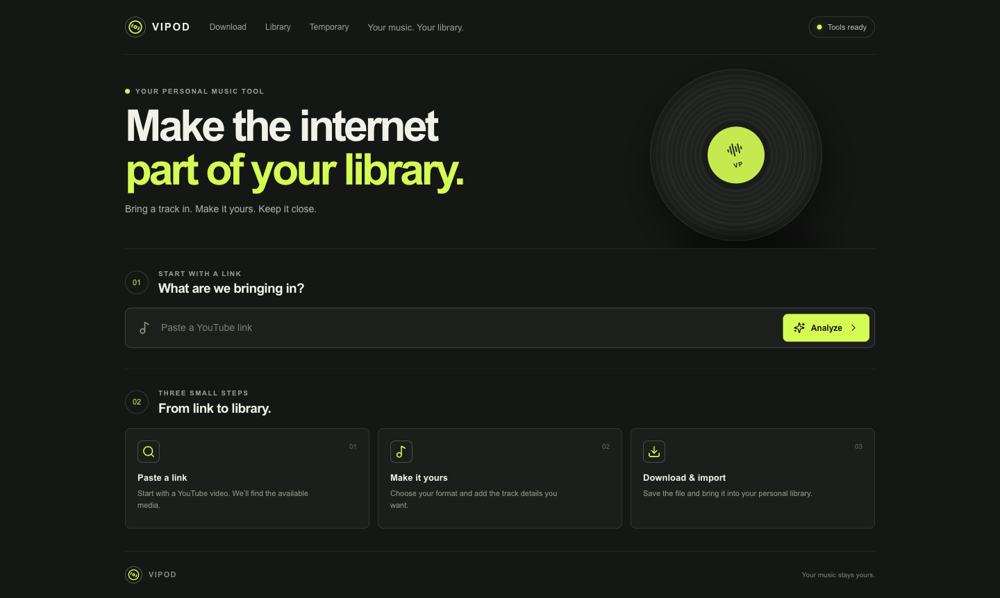
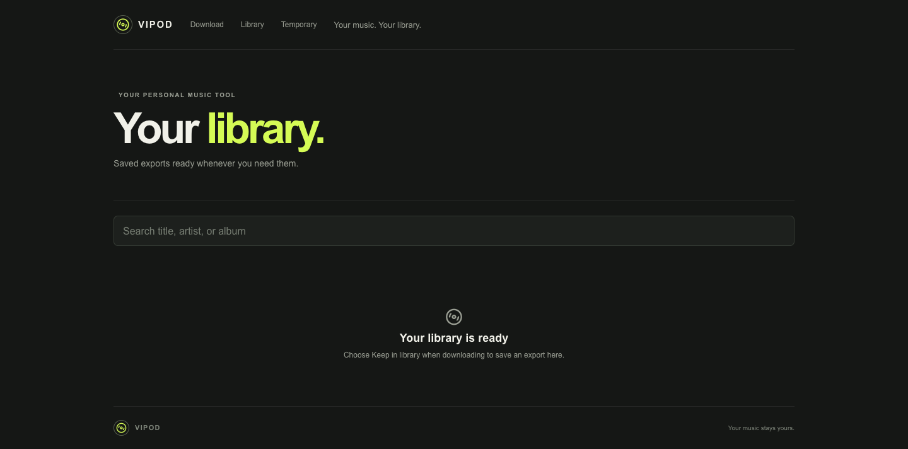

# VIPOD Web

A personal Mac-hosted tool for preparing tagged audio from individual YouTube videos and importing it into the VIPOD iPhone app. The Mac serves the web UI on your Wi-Fi network; files are transferred manually to iPhone.

## Screenshots

| Download | Library |
|---|---|
|  |  |

## Quick start

Requires Node.js **22.13 or newer** (`node:sqlite` is used by the persistent export catalog), Homebrew, `yt-dlp`, `ffmpeg`, and `ffprobe`. The current setup uses Node 22.22.3, yt-dlp 2026.08.19, ffmpeg 8.1.2, and Deno 2.9.7 (installed with Homebrew's yt-dlp package).

```sh
brew install yt-dlp ffmpeg
npm install
npm run dev
```

Open `http://localhost:3000` on the Mac, or `http://MAC_LAN_IP:3000` on an iPhone on the same Wi-Fi. Both app scripts bind to `0.0.0.0`; keep the Mac awake and the server running while using the iPhone. Find its LAN IP in macOS Network settings.

For stable long downloads, use one production Next.js process:

```sh
npm run build && npm start
```

The app is a current Node.js application, not a serverless deployment. Keep one server process: its in-memory queue runs one job at a time and accepts up to eight queued/running jobs.

## Prepare and import a track

1. Paste one YouTube video link and choose **Analyze**.
2. Choose source formats and output. M4A or MP3 is recommended for VIPOD; the original format may not be supported by the iPhone app.
3. Edit tags manually, or search MusicBrainz, choose the matching recording and release, and apply its details and available cover art.
4. Optionally enable **Keep a copy in my library** (initially unchecked; the browser remembers your preference), create the job, and wait for completion. Save the media file and, optionally, its separate JSON companion.
5. AirDrop the file to iPhone or save it through Files, then open VIPOD and choose **Import Music**. The iPhone app imports MP3, M4A, WAV, and AIFF files.

An already-lossy source cannot regain missing quality through conversion or a higher bitrate. Available formats vary by video. The JSON companion is an optional separate source/details export, not a guarantee that every source field can be embedded in audio tags. MusicBrainz uses its public read API without an API key. Search results require choosing a recording and release; channel names are not reliable artist credits, and upload dates are not release dates. If Cover Art Archive has no cover, use the video thumbnail, no artwork, or edit tags manually.

## Jobs and server library

Completed exports appear in **/temporary** by default. The optional **Keep a copy in my library** setting saves a permanent copy; promotion from temporary to permanent copies the completed media and does not download it again. Permanent files survive server restarts and the original job's expiry. The library contains final media only, plus the optional separate JSON companion. Temporary exports and terminal job records expire after 24 hours by default (`JOB_TTL_HOURS`). On initialization, valid completed job exports can be recovered into the catalog; unfinished jobs are marked failed as interrupted and do not resume. The SQLite catalog migrates automatically to schema 2 without deleting existing exports. Older completed exports without an analysis snapshot cannot provide a newly requested JSON companion (`409 INFO_UNAVAILABLE`).

Exact reuse requires a matching video ID, selected options/formats, and metadata; matching a title alone is not enough. Changing tags or formats requires a new version. Deleting the server library copy does not remove a copy already saved on a device.

Jobs and catalog state live under `.vipod-data/` by default (gitignored). The catalog uses SQLite at `.vipod-data/library.sqlite`; library media is stored under `.vipod-data/library/`. Set `DATA_DIR` to relocate all persistent job and library data. Jobs remain in the single-process in-memory queue model.

The UI queries server state through the API; Zustand stores client-side preferences, not the persistent library catalog. The app has no authentication and is intended for a trusted personal LAN. Do not expose it to the public internet.

## Configuration

All settings are optional. Defaults below reflect `src/lib/server/config.ts` and the MusicBrainz service.

| Variable | Default | Purpose |
|---|---|---|
| `YT_DLP_PATH` | `yt-dlp` (resolved via `PATH`) | yt-dlp executable |
| `FFMPEG_PATH` | `ffmpeg` (resolved via `PATH`) | ffmpeg executable |
| `FFPROBE_PATH` | `ffprobe` (resolved via `PATH`) | ffprobe executable |
| `FFMPEG_LOCATION` | unset; falls back to `FFMPEG_PATH` | Optional yt-dlp ffmpeg location |
| `DATA_DIR` | `<project>/.vipod-data` | Job manifests, catalog, and stored media |
| `MAX_DOWNLOAD_BYTES` | `2147483648` (2 GiB) | Maximum downloaded/final file size; `MAX_DOWNLOAD_MB` can set MiB instead |
| `MAX_DURATION_SECONDS` | `14400` (4 hours) | Maximum accepted video duration; falls back to `MAX_VIDEO_DURATION_SECONDS` |
| `JOB_TTL_HOURS` | `24` | Lifetime of temporary exports and terminal job records |
| `DOWNLOAD_TIMEOUT_MS` | `1800000` (30 minutes) | Maximum job elapsed time |
| `OUTPUT_TIMEOUT_MS` | `1800000` (30 minutes) | Media output process timeout |
| `MUSICBRAINZ_USER_AGENT` | `vipod-web/0.1.0 (personal local music library)` | Optional MusicBrainz contact/application identifier |
| `ALLOWED_ORIGINS` | empty | Comma-separated extra origins accepted by write endpoints |

The executable defaults resolve through the process `PATH`; no fixed Homebrew path is assumed. A custom `DATA_DIR` outside the project is not automatically gitignored. Optional shell settings can be loaded from `configuration.example.txt` in the same terminal before starting the app.

## API reference

Errors use `{ "error": { "code": "...", "message": "..." } }`.

| Method and path | Purpose / success response |
|---|---|
| `GET /api/health` | Tool availability and versions: `{ ready, tools }` |
| `POST /api/analyze` | JSON `{ "url": "..." }`; returns `MediaInfo` |
| `GET /api/metadata/search?q=...` | MusicBrainz candidates: `{ results: [...] }` |
| `GET /api/metadata/releases/{id}` | Release details and tracks: `MetadataRelease` |
| `POST /api/downloads` | `DownloadRequest` with optional `keepInLibrary` boolean; returns `DownloadJob` with HTTP 202 |
| `GET /api/downloads` | `{ jobs: DownloadJob[] }` |
| `GET /api/downloads/{id}` | Current `DownloadJob` |
| `DELETE /api/downloads/{id}` | Cancels an active job and returns `DownloadJob` |
| `GET /api/downloads/{id}/file` | Streams completed media as an attachment |
| `GET /api/downloads/{id}/info` | Streams optional JSON companion |
| `GET /api/library?retention=temporary\|permanent&q=...` | `{ items: LibraryItem[] }`; filters are optional |
| `POST /api/library/{id}/retain` | Promotes a temporary export; returns `LibraryItem` |
| `DELETE /api/library/{id}` | Deletes the server copy; returns HTTP 204 |
| `GET /api/library/{id}/file` | Streams stored media |
| `GET /api/library/{id}/info` | Streams its optional JSON companion |

`DownloadJob` may include `libraryItemId`, `reused`, and `retentionError`. After creating a job, poll its status until terminal. A completed response includes `downloadUrl`, optional `infoUrl`, and `expiresAt`.

## Scripts and troubleshooting

| Command | What it checks/does |
|---|---|
| `npm test` | Runs the aggregate test suite |
| `npm run test:server` | Runs server tests with the React server condition |
| `npm run test:ui` | Runs UI tests with normal React conditions |
| `npm run typecheck` | Runs TypeScript without emitting files |
| `npm run lint` | Runs ESLint across the project |
| `npm run build` | Builds the production Next.js app |

For an isolated production-runtime library fixture, see [`scripts/seed-library-verification.ts`](scripts/seed-library-verification.ts). It requires an explicitly named, empty verification `DATA_DIR` and never targets `.vipod-data`.

If the health indicator reports missing tools, check `command -v yt-dlp`, `command -v ffmpeg`, and `command -v ffprobe`; configure the corresponding `*_PATH` setting if needed. YouTube extraction depends on upstream availability and can fail for restricted, private, removed, or bot-checked videos. For extractor changes, update yt-dlp with `brew upgrade yt-dlp` and try again.

## Project map

- `src/app/page.tsx` — main web interface
- `src/app/api/` — API route handlers
- `src/lib/contracts.ts` — shared API and UI types
- `src/lib/server/` — media analysis, metadata lookup, jobs, and library catalog
- `tests/` — automated tests
- `.vipod-data/` — ignored local jobs, catalog, and generated media
